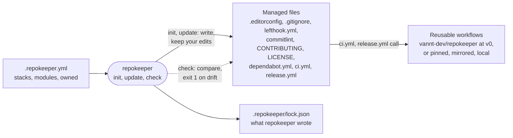

# repokeeper

[](https://vannt-dev.github.io/official.html)

Keep every repository on one maintained standard: Conventional Commits, git hooks, community health
files, editor and gitignore settings, Dependabot, CI and releases — applied once and kept in sync as
the standard evolves.

> Status: early development. Supported stacks: Node.js (including NestJS), Python, Dart and
> Flutter, shell and PowerShell scripts, Java (Maven and Gradle), Kotlin, .NET, Go, Rust, PHP, Ruby
> and Dockerfiles, each with CI and releases, on GitHub and on GitLab, plus repository settings through
> `repokeeper github apply` and `repokeeper gitlab apply`. See the
> [design](docs/superpowers/specs/2026-09-25-repokeeper-design.md).

## How it works



One file describes the repository (`.repokeeper.yml`); repokeeper turns it into the managed files and
remembers what it wrote, so it can tell your edits from its own. `check` only compares; `update`
moves the files to a newer standard and leaves alone what you changed or listed under `owned`.

## Usage

repokeeper is [on npm](https://www.npmjs.com/package/repokeeper). Install it once, or run it without
installing by putting `npx` in front of each command below:

```bash
npm install --global repokeeper
```

To work on repokeeper itself, build it from source and link the command instead:

```bash
git clone https://github.com/vannt-dev/repokeeper.git
cd repokeeper && npm ci && npm run build && npm link
```

Then, in the repository you want to standardise (commit your work first — repokeeper refuses to
write over uncommitted or untracked files unless you pass `--force`):

```bash
repokeeper init     # detect the stack, write .repokeeper.yml, apply the standard
repokeeper check    # report drift; exits 1 when the repository has drifted
repokeeper update   # move to the latest standard without overwriting your edits
```

`init` never overwrites a file you already have: it reports it as unmanaged. Pass
`--adopt <path>` to let repokeeper manage it, or list it under `owned` in `.repokeeper.yml` to keep it
yours. `owned` also takes a single key of a shared file, such as `.github/workflows/ci.yml#on` or
`package.json#devDependencies.lefthook`; repokeeper then leaves that key, and everything under it,
alone. Every write command accepts `--dry-run`.

Keep your formatter off the files repokeeper writes: a reformatted copy no longer matches, and
`check` reports it as edited. With Biome (2.6 also formats Markdown and YAML) or Prettier in a Node
repository, `init` and `update` name the new files to exclude in `biome.json` or `.prettierignore`.

`init` applies the whole standard unless you say otherwise:

- `repokeeper init --preset essential` writes only the editor settings, `.gitignore` and the CI
  workflow. `standard` is the default. `strict` adds the drift check to CI and, on GitHub, writes
  branch protection (pull requests with one approval, no force push, the commit check required) and
  Dependabot security updates into `.repokeeper.yml`; `repokeeper github apply` then puts them in
  place. On GitLab it writes the protection of the default branch (Maintainers push and merge, no
  force push) and a merge request that needs a passing pipeline, for `repokeeper gitlab apply`; a
  required review is not part of it, because approval rules are a paid-tier setting there. No preset
  switches code or secret scanning on: they are free on a public repository and paid on a private
  one, so they are yours to ask for (see below).
- `repokeeper init --interactive` (or `-i`) asks about each part in turn, naming the files it would
  write, shows the result, and asks once more before writing anything. Enter keeps the preset's
  answer. Add `--dry-run` to go through the questions without the possibility of writing.

Either way the choice ends up as plain `modules:` switches in `.repokeeper.yml`, which you can change
later and apply with `repokeeper update`.

These switches are in no preset:

- `modules.autoupdate: true` adds a weekly workflow that runs `repokeeper update` with the newest
  repokeeper and opens a pull request when the standard has moved, so a new standard reaches every
  repository without anyone running the command in each (GitHub only; see
  [CI and releases](docs/ci-and-releases.md#update-pull-requests)).
- `modules.security: true` adds a workflow that runs CodeQL on every pull request, on every push to
  the default branch and once a week, for the languages of your stacks (GitHub only; see
  [CI and releases](docs/ci-and-releases.md#code-scanning)). Secret scanning is a setting of the
  repository: `github.security.secret_scanning`, applied by `repokeeper github apply`
  ([GitHub settings](docs/github-settings.md)).
- `modules.cache_cleanup: true` adds a workflow that deletes the Actions caches nothing will read
  again: a pull request's caches when it closes, and in a weekly sweep the caches of closed pull
  requests and the older copies of a cache that a newer run saved again (GitHub only; see
  [CI and releases](docs/ci-and-releases.md#cache-cleanup)).
- `modules.automerge: true` adds a workflow that turns on auto-merge for Dependabot's patch and minor
  updates, so they merge once the checks and reviews the default branch requires have passed; majors
  stay manual (GitHub only; see [CI and releases](docs/ci-and-releases.md#dependabot-auto-merge)).
- `modules.publish: true` adds a job to the release workflow that publishes each release of a node
  package to npm, or of a python package to PyPI, through trusted publishing: no token is stored, and
  npm adds provenance. The registry needs a one-time trusted publisher entry (GitHub only; see
  [CI and releases](docs/ci-and-releases.md#publishing-to-npm-and-pypi)).
- `modules.workflow_lint: true` adds a workflow that checks the GitHub Actions workflows themselves:
  [actionlint](https://github.com/rhysd/actionlint) for mistakes and
  [zizmor](https://docs.zizmor.sh/) for security problems such as unpinned actions or template
  injection. What repokeeper writes passes both; workflows of your own may need fixes first (GitHub
  only; see [CI and releases](docs/ci-and-releases.md#workflow-lint)).

`init` writes an MIT `LICENSE` with the copyright line it reads from git (`modules.health.copyright`,
such as `2026 Van Nguyen`). Set `modules.health.license` to another SPDX id for that licence instead:
`Apache-2.0`, `BSD-3-Clause`, `GPL-3.0-only`, `GPL-3.0-or-later`, `ISC`, `MPL-2.0` or `Unlicense`.
The full texts ship with repokeeper, as [choosealicense.com](https://choosealicense.com/) publishes
them. BSD-3-Clause and ISC take the copyright line; the others have no holder line to fill, and the
two GPL ids share one text (the notice in each file says which applies). `false` leaves licensing
alone. `update` moves a `LICENSE` it wrote to the licence you name, but keeps one you edited and
writes the new text beside it as `LICENSE.repokeeper-new`. The `license` field of `package.json` or
`pyproject.toml` is yours: change it to match.

You can also start from the file instead of from detection: put a `.repokeeper.yml` you wrote
yourself in the repository and run `repokeeper init`. When the file is there and repokeeper has not
applied anything yet, `init` applies it as it is written. Nothing is detected, `--stack`,
`--platform` and `--preset` are refused, and the only line it changes is `standard:`, which it sets
to the standard it applied.

The [playground](https://vannt-dev.github.io/repokeeper/) writes that file for you: tick the stacks
and the parts you want, and it shows the `.repokeeper.yml` and the command to run.

`init` reads the default branch from `origin/HEAD` and records it as `github.default_branch` when it
isn't `main`. The release manifest starts from the latest `vX.Y.Z` tag when the stack has no version
of its own.

After writing, repokeeper prints what is left to do (installing the git hooks, and
`git add --renormalize .` when tracked files are stored with CRLF). `init`, `update` and `check` also
point out what they can't fix: `.gitattributes` lines above the repokeeper block that the block
overrides, and pull request workflows of your own that run the same tests as the repokeeper ci job.

Stack notes: Python runs `mypy` on the files its config names (`files = …`), or on the whole tree
otherwise. The dotnet stack needs SDK-style projects; `init` stops with the names of .NET Framework
projects, which the dotnet CLI can't build.

Requires Node.js 22.12 or newer.

## Status across repositories

`repokeeper github status` looks at every repository of a GitHub user or organization and lists the
ones that need attention. It runs from any folder and writes nothing:

```text
$ repokeeper github status --owner vannt-dev
repo               prs  alerts    ci    unreleased                    graph      standard
aspnet             0    0         none  no tags                       stale (2)  -
dynamic-field-kit  0    0         ok    6 since v1.12.0 (1 feat/fix)  ok         1.4.4
region-snap        0    0         ok    0 since v1.2.0                ok         1.3.0 (1.4.4 out)
web-ban-hang       0    1 medium  none  no tags                       ok         -

stale dependency graph (GitHub still reads old versions; a commit touching the manifest makes GitHub re-read it):
  aspnet: nuget Microsoft.Owin 3.0.1 in the graph, 4.2.2 in OnlineShop/packages.config
  aspnet: nuget bootstrap 3.0.0 in the graph, 3.4.1 in OnlineShop/packages.config

standard behind: region-snap (run `repokeeper update` there)

54 of 58 repositories clean, 4 need attention
```

For each repository that is not archived (forks only with `--forks`) it reads:

- **prs**: open pull requests, with the combined state of their check runs.
- **alerts**: open Dependabot alerts by severity; `off` when Dependabot alerts are disabled.
- **ci**: the latest finished run of each workflow on the default branch. Dependabot's update jobs,
  Pages deployments, pull request runs and cancelled or skipped runs are left out; `none` when nothing
  ran. A failure is listed with its date and link, since it may be an old run of a workflow that no
  longer runs on that branch.
- **unreleased**: commits on the default branch since the latest release (or the highest version
  tag), and how many of them are `feat`, `fix`, `perf`, `revert` or breaking, the commits
  release-please would release. Only those count as needing attention.
- **graph**: whether GitHub's dependency graph is stale. It compares the npm and NuGet versions of the
  graph's SBOM with the lockfiles on the default branch (`package-lock.json`, `npm-shrinkwrap.json`,
  `pnpm-lock.yaml`, `packages.config`) and reports a package the graph names at a version no lockfile
  contains while a lockfile has it at another one. GitHub then still raises Dependabot alerts for the
  old version, and they never close; any commit that touches the manifest makes GitHub read it again.
- **standard**: the repokeeper standard named in `.repokeeper.yml` on the default branch; `-` when the
  repository has none. One older than the standard of the repokeeper you run needs attention
  (`repokeeper update` there moves it); a newer one is shown but not flagged.

`--all` lists every repository, `--json` prints the whole result for a script, and `--exit-code`
exits 1 when a repository needs attention, for a scheduled workflow. `--owner` defaults to the user
the token belongs to; for another owner only public repositories are listed unless the owner is an
organization the token can read. The token comes from `GITHUB_TOKEN` or `gh auth token`; reading
Dependabot alerts needs a token with access to them (the `GITHUB_TOKEN` of a workflow sees only its
own repository). A repository that cannot be read, or hits the rate limit, is reported under
`could not check` and the others carry on.

## Guides

| Guide | What it covers |
| --- | --- |
| [CI and releases](docs/ci-and-releases.md) | The workflows repokeeper writes, pinning or mirroring the reusable workflows, `repokeeper eject`, script and Dockerfile linting, release-please, publishing to npm and PyPI, the drift check, update pull requests, code scanning, cache cleanup, Dependabot auto-merge, workflow lint |
| [Monorepos](docs/monorepos.md) | Stacks in folders: `stack_options.<stack>.directory`, what runs where, the limits |
| [GitHub settings](docs/github-settings.md) | `repokeeper github apply`: description, topics, merge settings and auto-merge, security, branch protection |
| [GitLab](docs/gitlab.md) | What differs on GitLab, the image each stack's job runs in, how releases write the version, the two jobs that need a token, and `repokeeper gitlab apply`: merge settings, branch protection, the Renovate schedule |

## Pilots

Each stack is tried on a real or demo repository before a release. The demo repositories carry the
[`repokeeper-demo`](https://github.com/topics/repokeeper-demo) topic:
[dart](https://github.com/vannt-dev/repokeeper-demo-dart),
[dotnet](https://github.com/vannt-dev/repokeeper-demo-dotnet),
[go](https://github.com/vannt-dev/repokeeper-demo-go),
[kotlin](https://github.com/vannt-dev/repokeeper-demo-kotlin),
[php](https://github.com/vannt-dev/repokeeper-demo-php),
[ruby](https://github.com/vannt-dev/repokeeper-demo-ruby) and
[rust](https://github.com/vannt-dev/repokeeper-demo-rust).

## License

MIT
